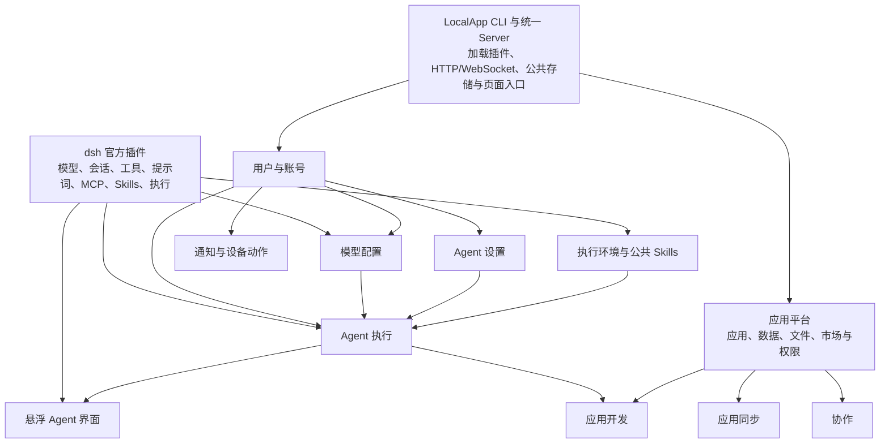
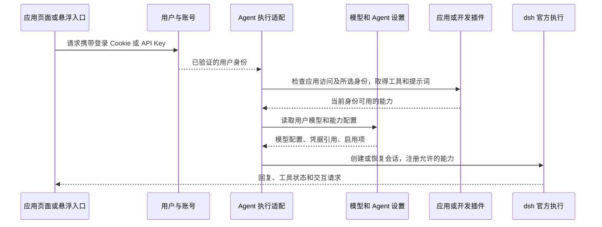

# LocalApp 插件拆分与社区复用方案

日期：2026-10-12。状态：已获实施授权，当前进展见 [实施记录](./dsh-plugin-refactor-status.md)。

本方案在现有 [插件方案](./dsh-plugin-suite.md) 和模型配置适配的基础上，进一步拆分职责。审核通过后，实施以本文的拆分范围为准，并更新旧方案中不再适用的内容。

## 目标与保留的行为

用户继续只安装一个 `@patodo/localapp` npm 包，使用同一个 `localapp` CLI 和统一 Server。内部插件可以独立加载、测试和关闭，不要求用户分别安装它们。前台与 daemon 使用同一套 Server；插件不创建第二个 HTTP 服务或 Server 启动器。

Agent 基础能力使用 dsh 官方插件；LocalApp 提供登录身份、应用权限、数据、托管和开发流程的适配。社区插件用于补齐具体功能，先验证再采用。

重构保留现有账号、模型配置、会话、应用、源码、文件和数据。正式应用入口、SDK、CLI 与已有 API 保持兼容。第一轮不改变首页或悬浮对话的交互设计，也不同时迁移存储格式。

## 当前问题

| 当前位置 | 当前包含的职责 | 本次调整 |
| --- | --- | --- |
| `packages/dsh-multiuser` | 账号、Agent 执行、运行实例、能力和 MCP 设置、Python 与系统环境、部分静态资源注册 | 保留账号；移出执行、设置和环境能力 |
| `packages/dsh-model-settings` | dsh 原生模型设置与每个用户的配置、凭据适配 | 保留，作为其他适配的参考 |
| `packages/dsh-agent-ui` | 悬浮入口与对话组件接入 | 保留，改为消费新的执行与设置服务 |
| `packages/dsh-app-platform` | 应用、数据、文件、同步、协作、通知和设备动作 | 保留应用、数据和文件；移出同步、协作、通知和设备动作 |
| `packages/dsh-app-development` | 源码、需求建应用、构建、预览、验证、上线 | 保留完整开发流程，改用新的公共服务 |
| `packages/dsh-document-tools` | 公共文档 Skills 清单、准备与依赖要求 | 并入执行环境与公共 Skills 插件，保留旧导出兼容入口 |
| `packages/server` / `packages/web` | 插件组装、登录和应用的宿主接入、页面与资源加载 | 保留公共宿主功能；功能逻辑逐步移到所属插件 |

## 插件结构

以下包名为实施建议，其中已有包尽量保持名称。图中箭头表示提供方把能力提供给消费方。

图表示主要依赖。应用平台把用户模式的工具和提示词注册到 Agent 执行服务；应用开发注册开发者模式。Agent 执行不反向导入应用平台或开发插件。

| 插件 | 建议包名 | 负责的服务和界面 | 可独立使用的方式 |
| --- | --- | --- | --- |
| 用户与账号 | `@localapp/dsh-multiuser` | 登录、账号、群组、API Key、身份解析、账号管理与个人资料 | 为其他 dsh 组合提供多用户身份 |
| 模型配置 | `@localapp/dsh-model-settings` | 原生供应商设置、模型列表、用户凭据与旧配置迁移 | 用户使用自己的模型，不依赖应用托管 |
| Agent 执行 | `@localapp/dsh-agent-runtime` | 会话、消息流、取消、恢复、运行实例、工具与提示词注册、权限变更后的实例失效 | 提供普通对话或应用 Agent API，可以不加载悬浮界面 |
| Agent 设置 | `@localapp/dsh-agent-settings` | 用户偏好、应用能力开关、MCP 配置、连接测试和状态 | 为执行插件提供配置，可使用页面或 API |
| 执行环境与公共 Skills | `@localapp/dsh-execution-environment` | 系统依赖检查、Python venv、公共 Skills 清单与准备、管理员环境设置 | 供 Agent 和构建流程共享，文档 Skills 可单独关闭 |
| Agent 界面 | `@localapp/dsh-agent-ui` | 悬浮入口、历史、身份切换、模型选择、附件、输入和运行状态 | 接入任意注册的对话入口 |
| 应用平台 | `@localapp/dsh-app-platform` | 安装与运行、数据 API、权限、迁移、备份、文件与 ZIP、应用市场、收藏、Issue | 无在线开发插件也能安装并使用应用 |
| 应用开发 | `@localapp/dsh-app-development` | 源码、需求建应用、编辑、构建、预览、页面标记和截图、验证、上线 | 为应用平台增加在线开发 |
| 应用同步 | `@localapp/dsh-app-sync` | 对端配置、源码与数据同步、冲突和任务进度 | 在本地与远程 LocalApp 之间同步应用 |
| 协作 | `@localapp/dsh-collaboration` | CRDT、在线状态、编辑提示、认证与传输 | 应用按需启用多人编辑 |
| 通知与设备动作 | `@localapp/dsh-device-services` | 订阅、收件箱、通知投递、设备连接、动作许可、执行结果 | 提供通知和本机动作，可分别开关 |

暂时不单独拆文件、应用数据、创建应用、预览或发布插件。它们与应用权限或完整开发流程关联紧密。通知与动作保留不同的内部服务；本次放在一个包中不意味着共享权限或必须同时启用。

## 官方能力与 LocalApp 适配

用户模式与开发者模式是两组能力，共用同一执行插件。历史按用户、应用和身份分开，模型供应商不作为会话身份。非应用所有者不能通过请求参数切换成开发者。

每次读取资源、执行工具和处理后台任务都检查身份与权限。注销、账号停用、配置变更和凭据撤销必须影响已有连接及后续执行。界面传入的用户、角色、目录或应用名不能直接授予权限。

LocalApp 适配只负责身份、实例范围、能力选择、存储位置和兼容接口，不重新实现模型协议、Agent 循环、MCP 传输或 dsh 对话事件体系。

## 社区复用范围

社区调查日期为 2026-10-12。下表描述仓库文档和依赖声明，不表示已在 LocalApp 中通过运行验收。

| 候选 | 本次用途 | 采用条件与决定 |
| --- | --- | --- |
| [Js2Hou/dsh-mcp-manager](https://github.com/Js2Hou/dsh-mcp-manager/blob/main/README_EN.md) | MCP 管理界面、连接测试和状态展示 | 优先做最小适配验证。当前使用 profile 配置和 loader；需确认界面能与用户配置分开接入，不能直接修改 Server 的全局 profile。仓库标注 MIT |
| [dingyi222666/dsh-session-notification](https://github.com/dingyi222666/dsh-session-notification) | 会话完成、失败等浏览器提醒 | 第一阶段后验证。绑定当前用户可见会话，不代替业务收件箱；浏览器通知许可由用户操作。仓库标注 BSD-3-Clause |
| dsh 官方模型、会话、工具、MCP、Skills、子 Agent 和任务插件 | Agent 基础能力 | 默认复用，使用项目固定的兼容版本；新适配不得引入第二份不兼容的 dsh 核心 |

社区源码可直接依赖时使用固定版本并保留上游更新方式；确实需要小范围改动时，单独保存适配和来源说明，不复制整套界面长期维护。不能分离全局配置、不能满足用户隔离或依赖版本不兼容时，不采用该候选，改为继续适配官方服务和项目现有 shadcn/ui 组件。

第一阶段将 MCP 接入做成独立模块，再决定采用社区界面，避免核心拆分依赖候选的验收结果。最终使用的社区版本、许可证文件、改动范围和依赖需记录在仓库中。

### 本次不引入

| 方案 | 不引入的原因 |
| --- | --- |
| MinerU、文档知识库与 OCR 服务 | 当前是职责拆分，现有 PDF、Word、Excel、MarkItDown Skills 保留；不增加文档服务、模型或部署要求 |
| 社区登录系统 | 不能直接代替现有应用所有者、组织、API Key 和业务权限；保留当前账号和存量数据 |
| SSH/SFTP 远程工作区 | 可用于其他远程开发场景，但不能代替应用版本、数据库、附件和身份映射的同步 |
| Live Canvas 或整套社区 Web UI | 不更换已有应用开发和悬浮对话产品流程 |
| microVM、桌面浏览器扩展、独立 Desktop | 本轮不改变执行后端和产品安装方式 |

## 插件之间的接口

插件通过 Cordis 服务调用，不导入其他插件的内部文件。共享数据类型放在小型公共类型模块；它不是独立产品插件，也不启动服务。

| 提供方 | 提供的接口内容 | 消费方 |
| --- | --- | --- |
| 用户与账号 | 身份解析、用户查询、权限变更事件 | 模型、Agent、应用和设备服务 |
| 模型配置 | 不含密钥的模型目录、执行时的配置和凭据解析、配置变更事件 | Agent 执行与设置界面 |
| Agent 设置 | 用户偏好、应用能力选择、MCP 定义与状态、变更事件 | Agent 执行、悬浮界面和应用设置 |
| 执行环境 | 环境报告、Python 执行配置、Skills 可用性与准备 | Agent 执行和应用构建 |
| Agent 执行 | 创建与恢复会话、发送与停止、历史与订阅、按身份注册能力、实例失效 | 应用平台、应用开发和悬浮界面 |
| 应用平台 | 应用查询与权限、文件读写、数据操作、安装产物与版本 | 开发、同步、协作和通知 |
| 应用开发 | 开发入口及其工具、预览与构建状态、上线操作 | 悬浮界面和应用平台 Shell |

HTTP 路由、静态资源、导航入口和设置项由所属插件注册，统一 Server 提供宿主。现有 `/my/models` 继续组合模型与 Agent 设置，用户不必理解内部插件拆分。

普通 Web 设置使用项目 shadcn/ui；明确复用的 dsh 原生或社区组件通过薄适配接入。Lucide 图标与平台导航左右分区继续遵循项目规则。

## 加载、关闭与发行

采用明确的组合配置，逐步替代当前只有 `multiuser`、`platform`、`full` 的粗粒度选择；旧配置映射到等价组合继续可用。

| 组合 | 加载内容 |
| --- | --- |
| 多用户 Agent | 账号、模型、Agent 设置、Agent 执行；界面与执行环境可选 |
| 应用运行 | 账号、应用平台；Agent、协作、通知和设备动作可选 |
| 完整 LocalApp | 全部默认功能，保留当前完整体验 |

关闭悬浮界面不关闭 Agent API。关闭应用开发后正式应用继续运行。关闭公共 Skills 不关闭 Python 环境或影响已有应用数据。关闭通知或动作只停止对应能力。

关闭提供方前检查依赖：启动配置缺少必需服务时明确报错；管理员关闭操作应展示受影响的能力，不静默关闭其他功能。第一轮按保存配置、重启 Server 生效，不承诺全部插件动态卸载。

插件停止要结束自身连接、定时器和任务资源。进行中的任务记录明确结果，不把中断写成成功。插件关闭不删除任何数据，重新启用可以恢复已有内容。

发行包包含默认组合的代码、客户端资源、Skills 和依赖。社区可选项未通过验收前不加入默认组合。只发布一个 LocalApp npm 包，本方案不要求单独发布内部插件。

## 实施阶段

| 阶段 | 工作 | 完成条件 |
| --- | --- | --- |
| 0：基线 | 列出已有 API、导出、页面、存储、插件组合和用户路径；保存测试数据 | 明确现有行为及已知失败，后续不能把旧问题隐藏成通过 |
| 1A：Agent 执行 | 从 multiuser 移出 Harness、运行实例、会话接入和能力组装；应用与开发入口使用统一服务 | 用户与开发者两种身份、历史、模型切换、工具、取消、重连及权限变更通过 |
| 1B：Agent 设置与 MCP | 移出偏好、能力和 MCP 配置；验证社区 MCP 界面的最小接入 | 旧配置保留；双用户、双应用配置不串用；启停、连接失败和状态展示通过 |
| 1C：执行环境与 Skills | 合并系统环境、Python venv 和公共文档 Skills；构建流程改用公共服务 | 管理员设置可用；普通用户不能修改；依赖不足时前端与 API 都阻止启用 |
| 2：其他附加能力 | 拆出同步、协作、通知和设备动作；评估社区会话提醒 | 逐项验证旧数据、插件关闭及重新启用；正式应用继续可用 |
| 3：组装与发行检查 | 精简 Server 组装，完成旧组合兼容和资源打包 | 全新安装包和已有数据升级通过；不依赖开发机 workspace 或额外 Server |

每阶段先移动现有行为，再做必要适配。保留旧包导出和 API 的转发入口，但同一份数据只有一个实际写入实现。公共 Skills 旧名称 `dsh-document-tools` 保留兼容导出，不再创建另一套存储与运行实例。

第一阶段优先保持目录、数据库表、加密格式和会话标识；若发现必须迁移数据，先说明具体原因、备份与恢复步骤，更新本方案后再实施该迁移。

## 验收清单

| 范围 | 必须执行的验证 |
| --- | --- |
| 配置兼容 | 旧供应商、默认模型、MCP、能力选择、Python 环境与 Skills 选择读取和保存正确 |
| 用户隔离 | 两用户会话、供应商凭据、MCP、文件和任务互不串用；伪造参数不能跨用户访问 |
| 身份与权限 | 普通用户不能编辑源码；所有者可切换身份且历史分开；停用、注销、撤销凭据影响后续请求 |
| Agent 执行 | 真实配置供应商完成文本和工具请求；多模态模型完成图片请求；停止、追问、重连、恢复正确。模拟供应商结果单独标明 |
| MCP | stdio 与 HTTP 测试服务验证连接、工具调用、启停、错误和恢复；服务器凭据不返回页面 |
| 公共 Skills | 从正式应用上传真实 PDF、DOCX、XLSX 并处理；现有 venv 与新建 venv 可用；缺少依赖明确提示 |
| 应用开发 | 需求建应用、会话归属、源码编辑、构建、预览、页面标记与截图、验证、上线完整路径通过 |
| 应用数据与文件 | 保留生产／测试读写选择、生产复制到测试；Excel 与附件生成单个 ZIP，越权文件不能导出 |
| 应用同步 | 本地与远程源码、二进制资产、数据与附件按选择同步；基准冲突和失败明确呈现 |
| 协作 | 两用户正式入口协作、编辑提示、离线重连与持久化；Awareness 不进入数据库和同步包 |
| 通知与动作 | 会话及业务通知正确归属；设备动作执行检查当前用户和动作许可；关闭不影响应用运行 |
| 插件组合 | 多用户 Agent、应用运行、完整组合分别启动；缺依赖报错；关闭再启用不丢数据 |
| npm 发行包 | 构建后在全新目录启动同一 Server，配置页、对话和默认插件资源可用 |

所有测试项目、Server 数据、上传、下载和截图放在本仓库 `tmp/` 下。应用验收从 `/{owner}/{app}/` 正式入口进行，类型检查和原始资源接口不能代替页面验证。

## 本次审核事项

1. 是否认可上述 11 个插件，以及暂时保留应用数据与文件在应用平台内。
2. 是否认可先实施 Agent 执行、Agent 设置、执行环境与公共 Skills，再拆其他能力。
3. 是否认可社区仅优先验证 MCP 管理界面和会话提醒，其余本轮不引入。
4. 是否认可第一轮保持存储与 API 兼容，插件配置保存后重启生效。

本轮仅编写方案。审核通过后再改实现；提交、发布与服务器部署不属于本轮工作。
